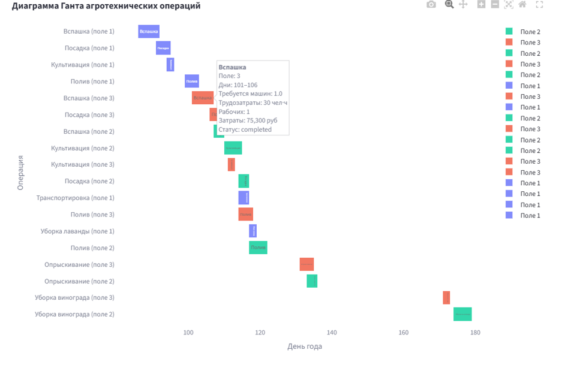
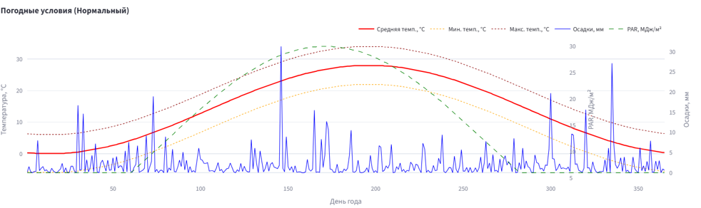
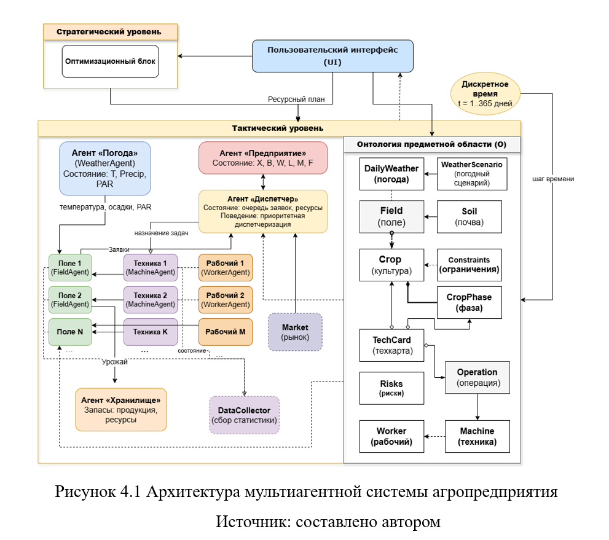
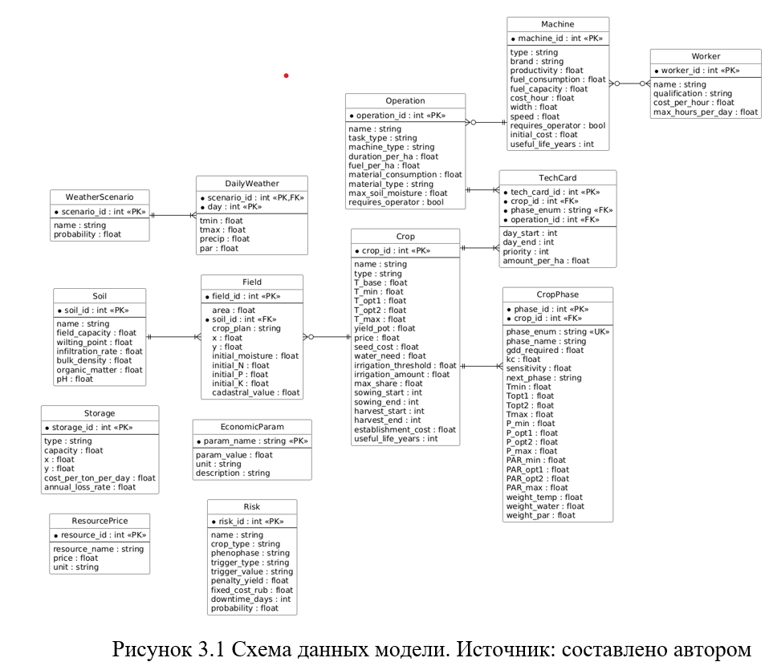

# Adaptive Digital Model of an Agricultural Enterprise
### Multi-agent simulation and LP optimization for resource planning under climate uncertainty

A two-level decision-support system for agricultural enterprises. A
**linear-programming layer** picks the crop mix under water, budget and
labour constraints; an **agent-based simulation layer** runs the season day
by day — phenology, soil-water balance, machine dispatch, risks and adaptive
re-planning. Wrapped in an interactive **Streamlit** dashboard.

The model is not tied to a single crop: it is parameterized by a catalog of
crops and technological cards, so the same engine applies to vineyards,
essential-oil crops, grains and orchards. The validation case is a Crimean
farm with Cabernet Sauvignon, Merlot and narrow-leaved lavender.

---

## 🌍 Motivation

Agricultural enterprises face hard constraints that a static seasonal plan ignores:

- **Water deficit** reaches **40–70%** of the irrigation demand in dry years.
- **Narrow phenological windows** — flowering lasts only **7–14 days**, and
  missing it costs a large share of the potential yield.
- **Drought risk** during critical phases can reduce the harvest by
  **30–50%**.

Classical LP / MILP models use averaged seasonal norms and cannot re-plan
when the season deviates. Agro-physiological models (DSSAT, CropSyst) need
≈50 calibrated parameters per crop and are not transferable across regions.
This project fills the gap with a **hybrid LP + MAS** approach: an LP sets
target areas, an agent-based simulation runs daily dispatch, and an
**adaptive mechanism** raises resource limits when the plan is hitting a
constraint.

---

## 🎯 What the model does

Given the enterprise's resources (fields, machines, workers, storages), a
catalog of crops and their phenology, technological cards, weather scenarios
and prices, the model answers three questions:

1. **How to allocate area between crops** to maximize expected profit under
   water, budget and labour constraints — solved as an LP with PuLP / CBC.
2. **How the season unfolds day by day** when the plan is executed, given
   the weather of a chosen scenario — simulated with a Mesa multi-agent model.
3. **How robust the plan is** if the weather turns out dry or wet — every
   scenario is simulated, adaptive re-planning is allowed, and the result is
   compared with a non-adaptive baseline.

The interactive dashboard lets you edit every input table, switch scenarios,
and compare plans, adaptations and financial outcomes side by side.

---

## 🔍 How it compares to existing approaches

| Approach | Weather stochasticity | Resource dynamics | Data demand | Fit for agriculture |
|---|---|---|---|---|
| LP / MILP | No (deterministic coefficients) | No (seasonal aggregates) | Low | Limited |
| Empirical regressions | Partial (weather predictors) | No | Medium | Low — not transferable |
| Agro-physiological (DSSAT, CropSyst) | Yes (daily weather) | Partial (growth, water) | Very high (≈50 params to calibrate) | Difficult |
| **This work: hybrid LP + MAS** | **Yes (scenario-based)** | **Yes (daily dispatch)** | **Moderate** | **Adapted — phases, water balance, adaptive limits** |

---

## 🏗 Architecture

Two-level design (see [`docs/architecture.png`](docs/architecture.png)):

- **Strategic level** — the LP chooses the crop mix.
- **Tactical level** — the agents execute the plan day by day.
- **Adaptive layer** — when a hard limit is hit, the model raises it and
  logs the change, so every deviation is visible in the report.

---

## 🧮 Model

### Phenology (GDD)

Phase transitions are driven by accumulated growing degree days:

A phase changes when cumulative GDD crosses its crop-specific threshold.
GDD thresholds are calibrated separately for each crop and phase
(e.g., Cabernet Sauvignon: flowering at 250 °C, lavender at 500 °C).

### Climate-yield stress model

For each climatic factor x :

### Soil-water balance (Ritchie)

### Crop-mix LP

---

## 🧩 Key features

- **LP crop-mix optimization** — PuLP maximizes expected profit subject to
  area, water, budget, machine-hour and labour constraints across scenarios.
- **Daily agent-based simulation** — Mesa agents with per-day phenology
  (GDD), soil-moisture balance, and operation scheduling.
- **Multi-scenario robustness** — normal / dry / wet weather, weighted by
  probability, with a joint robust plan.
- **Adaptive resource management** — the model can raise water / budget /
  machine / worker limits when a hard constraint is hit, and reports every
  adjustment.
- **Risks** — spring frost, mildew, pests, equipment breakdown, theft, with
  weather-triggered and random triggers, yield penalties and fixed costs.
- **Technological cards** — per-crop operation windows, priorities, resource
  consumption, labour and fuel rates.
- **Financial model** — revenue, variable cost, storage cost, admin cost,
  EBITDA, depreciation, property tax, income tax, net profit.
- **Streamlit dashboard** — editable input tables, scenario weights, LP vs
  current-plan comparison, Gantt charts, adaptation log, finance breakdown,
  side-by-side results **with** and **without** adaptation.

---

## 📸 Screenshots

| Gantt of agro-operations | Weather and yield |
|---|---|
|  |  |

| Architecture | Database schema |
|---|---|
|  |  |

---

## 🛠 Tech stack

- **Mesa 2.3.2** — agent-based modelling
- **PuLP** (CBC solver) — linear programming
- **Streamlit** — interactive dashboard
- **Pandas / NumPy** — data handling
- **Plotly** — charts (Gantt, multi-axis weather, stress curves)

---

## 📁 Project structure

Key modules in `core.py`:

- `Crop`, `CropPhaseInfo`, `Soil`, `Operation`, `TechCard` — domain objects.
- `FieldAgent`, `MachineAgent`, `WorkerAgent`, `WeatherAgent`,
  `StorageAgent`, `MarketAgent` — Mesa agents.
- `FarmModel` — the Mesa `Model` that orchestrates the day loop.
- `temperature_stress`, `water_stress`, `precip_stress`,
  `par_stress_with_phase`, `calc_gdd` — phenology helpers.
- `optimize_structure` — PuLP LP for crop mix.
- `adaptive_resource_optimization` — robust multi-scenario run.
- `compute_yield_scenarios`, `compute_period_norms`,
  `compute_full_variable_cost` — LP inputs.

---

## 📊 Inputs

All tables are editable in the **Data** tab, and can be uploaded from CSV:

| Table | Contains |
|---|---|
| `crops.csv` | crop catalog with temperature thresholds, water need, prices |
| `crop_phases.csv` | GDD requirements, stress thresholds, phase weights |
| `soils.csv` | field capacity, wilting point, infiltration |
| `fields.csv` | area, soil, crop plan, initial moisture and nutrients |
| `machines.csv` | type, productivity, fuel use, hourly cost, lifetime |
| `workers.csv` | qualification, hourly cost, max hours per day |
| `storages.csv` | capacity, per-ton-per-day cost, annual losses |
| `operations.csv` | task type, machine type, duration, fuel, material |
| `tech_cards.csv` | per-crop operation windows, priority, rate |
| `weather_daily.csv` | Tmin / Tmax / precip / PAR per day per scenario |
| `weather_scenarios.csv` | scenario name and probability |
| `constraints.csv` | water, budget, labour, machine-hour limits |
| `prices.csv` | fuel, water, seed, fertilizer, pesticide |
| `economic_params.csv` | depreciation, taxes, admin cost, realization rate |
| `risks.csv` | triggers, yield penalties, fixed costs, downtime |

---

👤 Author
Natachiazza — GitHub

Bachelor's thesis in Applied Mathematics and Computer Science, 2026.
